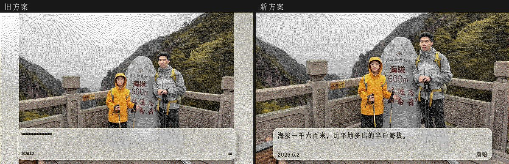
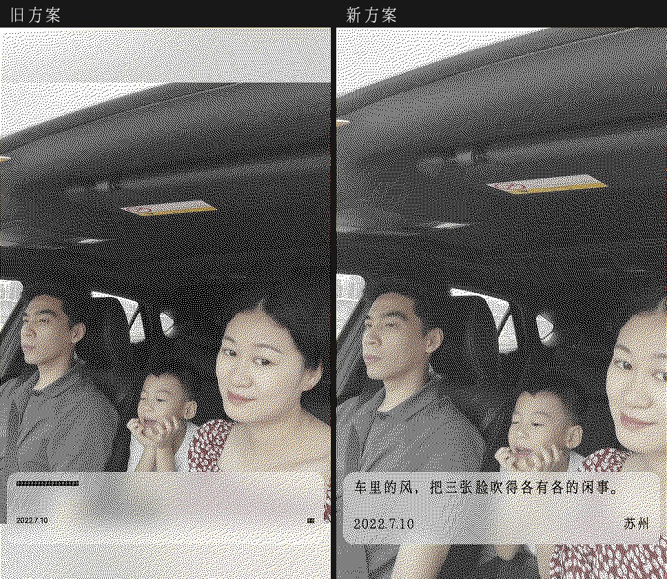
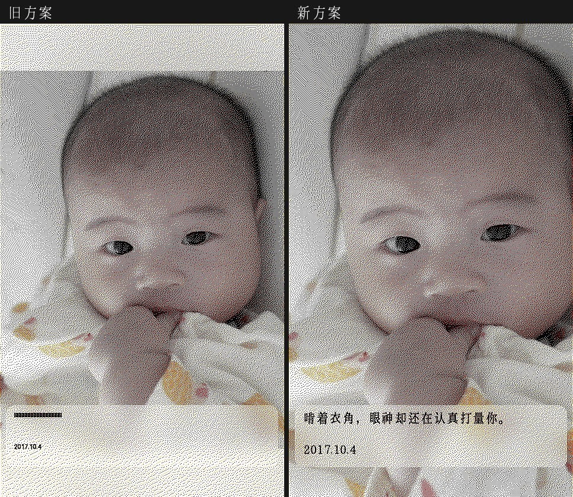
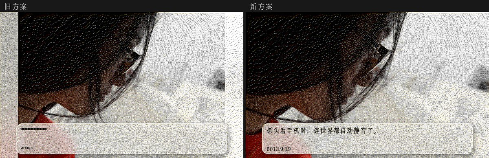
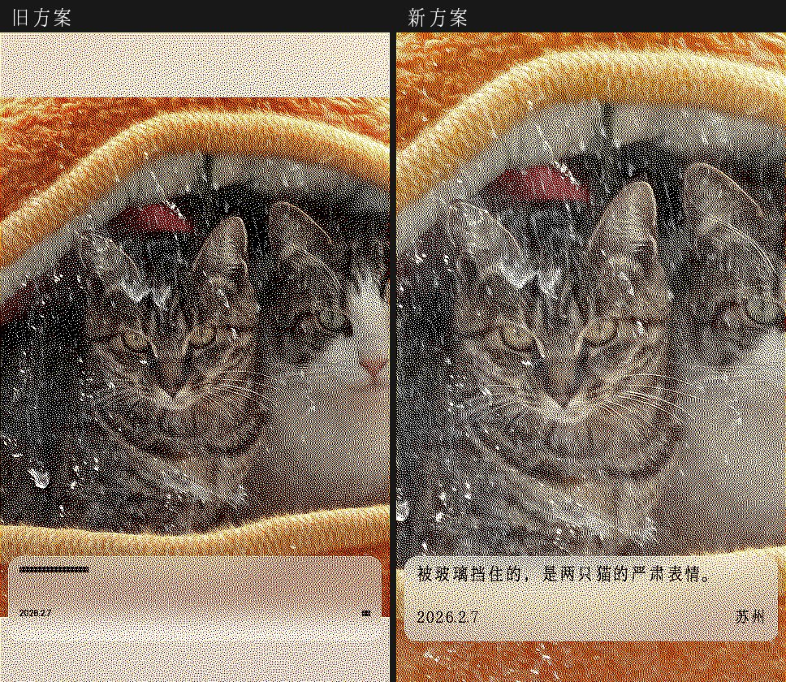
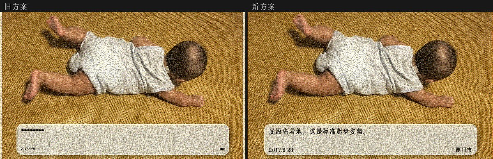

# 渲染裁剪方案对比报告：全出血 cover（新） vs 内容感知缩小 + 毛玻璃回填（旧）

> 生成日期：2026-09-11
> 样本：照片库随机 20 张（种子 `20260911`，可渲染候选池 27,237 张；横屏 6 张 / 竖屏 14 张；有 YOLO 主体 12 张 / 无主体 8 张）
> 对比对象：新 = commit `50102bf`（全出血）；旧 = `cc50dd3`（修复前最后一个版本）
> 两版的伽马、四色抖动、文字排版代码完全相同，**差异仅来自缩放与裁切策略**。

---

## 结论（TL;DR）

| 指标 | 旧方案（缩小+回填） | 新方案（全出血 cover） |
|---|---|---|
| 结构性白边（几何精确值） | **6/20 张（30%）**：横屏左右各 60px×2、各 7px×1；竖屏上下各 80px×3 | **0/20** |
| 主体 bbox 保留率 | 20/20 全保留（靠缩小换来的） | 16/20 全保留；4 张被裁（最差 59%） |
| 被裁主体是否切脸 | — | **0 例切脸**（均为头顶/躯干/四肢边缘出画） |
| 画面白色占比（发白程度） | 留白 6 张均值 49.1% | 同 6 张均值 43.6%（平均 **−5.5pp**，最大 −10.5pp） |

- 旧方案的白边**不是小概率事件**：只要照片检测到主体且主体群（含 5% 呼吸边距）装不进"文字卡以上空间"就触发缩小，样本中命中 6/6。这与"每天都有白边"的体感一致。
- 新方案的代价：4/20 张的主体 bbox 有出画部分（保留率 81% / 81% / 59% / 80%）。目视核对全部 4 张，**人物/动物面部均完整**，出画的是头顶、躯干边缘或四肢。
- 旧方案即使不触发缩小，`int()` 取整在浮点误差下也可能比画布少 1px，产生 1px 级白缝并轻微改变整图重采样——样本中 10 张因此有 0.1~0.5pp 的多余白色；新方案用 `ceil + 钳位` 消除了这条路径。

---

## 两种方案差在哪

```
旧方案：cover 缩放 → 若主体群装不下 → 整体缩小（最低缩到 cover 的 85%）
        → 空隙用「原图放大模糊 + 70% 白色蒙版」回填 → 四色抖动后 = 白边
新方案：永远 cover 铺满画布（ceil 防取整白缝）
        → 主体适配交给滑动窗口裁切（尽量完整框入最多主体 + 切人平方惩罚 + 底部文字卡避让）
```

## 明细（20 张全量）

「结构性白边」由两版各自的缩放几何精确算出（画布尺寸 − 缩放后尺寸，与画面内容无关）；
「白色占比」为抖动成品中纯白像素比例（辅助参考，亮色内容也会推高，见下文说明）；
「最差主体保留」= 该照片所有主体 bbox 中，映射到画布后仍在画面内的最小面积占比。

| # | 文件 | 朝向 | 主体 | 结构性白边 旧→新 | 白色占比% 旧→新 | 最差主体保留% 旧→新 | 备注 |
|---|---|---|---|---|---|---|---|
| 1 | IMG_20260502_084715.jpg | 横屏 | 2 | **左右各 60px**→无 | 58.8→48.3 | 100→100 | ✅ 白边消除，主体无损 |
| 2 | IMG_20250115_162455.jpg | 竖屏 | 2 | 无→无 | 47.3→46.8 | 100→100 | |
| 3 | IMG_20230407_152644.jpg | 横屏 | 0 | 无→无 | 57.4→57.1 | — | 亮色内容示例（见下） |
| 4 | P1030338.JPG | 竖屏 | 1 | **上下各 80px**→无 | 60.0→51.4 | 100→81 | 头顶小幅出画，面部完整 |
| 5 | IMG_20190606_174746.jpg | 竖屏 | 0 | 无→无 | 50.4→50.1 | — | |
| 6 | P1000366.JPG | 横屏 | 1 | **左右各 60px**→无 | 54.5→48.5 | 95→81 | 旧版本已裁 5%，新方案略多 |
| 7 | IMG_20240821_142120.jpg | 竖屏 | 3 | 无→无 | 50.2→49.9 | 100→100 | |
| 8 | IMG_20220710_114748.jpg | 竖屏 | 3 | **上下各 80px**→无 | 48.2→42.4 | 100→**59** | 车内三人：躯干部分出画，三人面部完整 |
| 9 | IMG_20170827_201008_905 (1).jpg | 竖屏 | 0 | 无→无 | 34.4→34.1 | — | |
| 10 | IMG_20260207_150552.jpg | 竖屏 | 1 | **上下各 80px**→无 | 37.4→36.3 | 100→80 | 猫头顶毛发裁切，面部完整；旧版卡片后正好是深色内容导致文案发黑，新方案顺带改善 |
| 11 | IMG_20260322_130722.jpg | 竖屏 | 0 | 无→无 | 33.8→33.8 | — | |
| 12 | IMG_20221006_110015_781.jpg | 竖屏 | 0 | 无→无 | 45.2→45.0 | — | |
| 13 | IMG_20160212_103257_514.jpg | 横屏 | 0 | 无→无 | 45.0→44.6 | — | |
| 14 | IMG_20160610_191730_337.jpg | 横屏 | 0 | 无→无 | 52.3→52.0 | — | |
| 15 | IMG_20251011_140204.jpg | 竖屏 | 1 | 无→无 | 38.9→39.0 | 100→100 | |
| 16 | IMAG1722.jpg | 竖屏 | 1 | 无→无 | 68.4→68.1 | 100→100 | 亮色内容示例（见下） |
| 17 | IMG_20240414_180925_1.jpg | 竖屏 | 2 | 无→无 | 42.9→42.9 | 100→100 | |
| 18 | IMG_20170918_213203_736.jpg | 竖屏 | 0 | 无→无 | 32.9→32.9 | — | |
| 19 | IMG_20240211_185426.jpg | 竖屏 | 1 | 无→无 | 46.5→46.5 | 100→100 | |
| 20 | IMG_20170828_193523_247(1).jpg | 横屏 | 2 | **左右各 7px**→无 | 35.8→34.6 | 100→100 | 轻微留白消除 |

> **亮色内容 ≠ 白边**：#3（白色床单为主）与 #16（白墙前拍摄）实测也有很高的"白色占比"读数、甚至边缘白色列，但两版读数一致、几何上零留白——那是照片内容本身亮。结构性白边只可能来自"缩放后没铺满"，新方案下为恒 0。
>
> **交叉校验**：由几何复算预测的 6 张旧方案留白，与抖动成品的实测白带全部对上（6/6 一致）。

## 重点案例对比图

**#1 横屏 60px 白边消除、主体无损（最典型场景）**



**#8 主体代价最大的一张（100%→59%）：三人全身合影装不进画面，旧方案整体缩小留上下白边；新方案保持满幅，躯干边缘出画但三人面部完整**



**#4 婴儿特写：旧方案上下各 80px 白边；新方案满幅，头顶略微出画**



**#6 旧方案左右各 60px 白边（右图为满幅效果）**



**#10 猫：旧方案顶部整条回填带、主体被缩小，且卡片后正好压在深色内容上导致文案难以辨认；新方案全部改善**



**#20 轻微留白（左右各 7px）**



其余 14 张几何策略未触发差异，渲染结果与旧版一致（其中 10 张因旧版取整白缝有 ≤0.5pp 的白色占比差异），对比图见 `img/p02.jpg` ~ `p19.jpg`。

## 指标口径与复现

- **结构性白边**：两版各自 `scale`/裁切窗/回填偏移的精确几何复算（内容无关），是本报告的主判据；
- **实测白带**：抖动成品上从四边向内数"纯白像素占比 >60%"的连续列/行——受照片亮色内容干扰，仅作交叉验证；
- **主体保留率**：`subjects_json` bbox 按两版各自几何映射到画布后的画面内面积占比；被半透明文字卡遮住的部分计为"在画面内"（卡片为毛玻璃，主体隐约可见，与"裁出画面"性质不同）；
- **确定性**：同照片重复渲染字节级一致；对比脚本连续两次运行全部 20×2 项指标完全一致。

复现方式（在仓库根目录）：

```bash
venv/bin/python scripts/compare_crop_schemes.py
```

脚本自动 `git show cc50dd3:render_daily_photo.py` 提取旧版快照到 `tmp/`，随机抽样（种子与张数在文件头 `SEED`/`N`）、双版本渲染、输出指标与本目录 `img/` 对比图。

## 后续可选优化（不影响本次结论）

1. 竖屏管线的 `compute_crop_window` 目前未传 `bottom_reserve`（文字卡避让只靠水平滑动），可补传 120px 进一步减少主体被卡片压住的概率（#2 卡后 59%、#19 卡后 40% 的场景会受益）；
2. 对 #8 这类"主体群物理上装不进画布"的全景合影，未来可在选片阶段加权规避，或引入 VLM 仲裁取舍（`docs/inktime-smart-crop-plan.md` 阶段二）。
